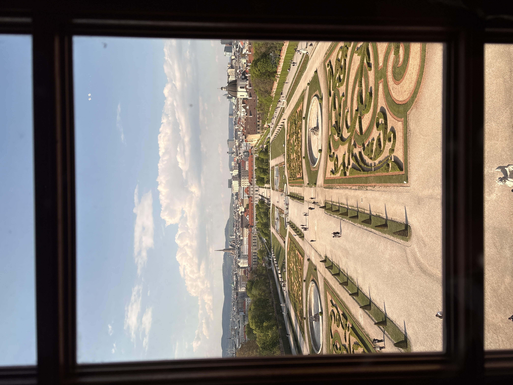
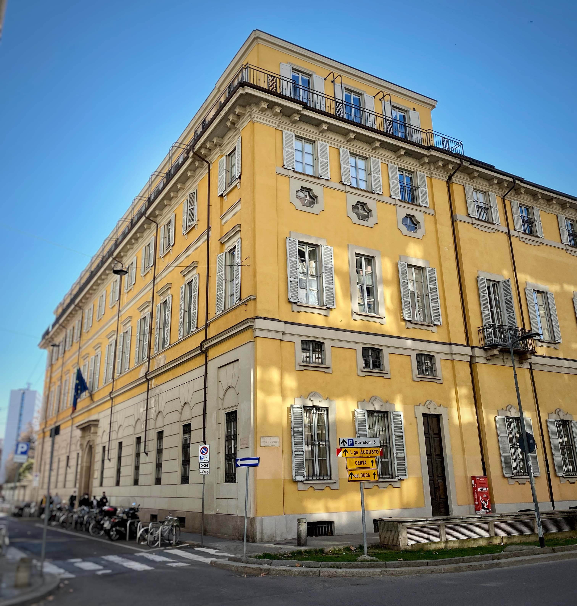

# marta887.github.io

Hi, I'm a Corporate Communication student at the University of Milan!

I like traveling so much and the last city I visited was [Vienna](https://www.wien.gv.at/en/) and I actually loved it!

## Course & Projects

- **[Course Repository](https://github.com/ale66/learn-web):** The main repository for the course, containing lectures, guidelines, and reference materials.
- **[Class Playground](https://github.com/ale66/learn-web-playground-2026-27):** The shared workspace used for weekly exercises and collaborative activities.
- **[My Refactoring Project](https://github.com/ale66/learn-web-playground-2026-27/tree/main/essays/marta887):** My individual refactoring project developed during the course.

## Campus Surroundings

